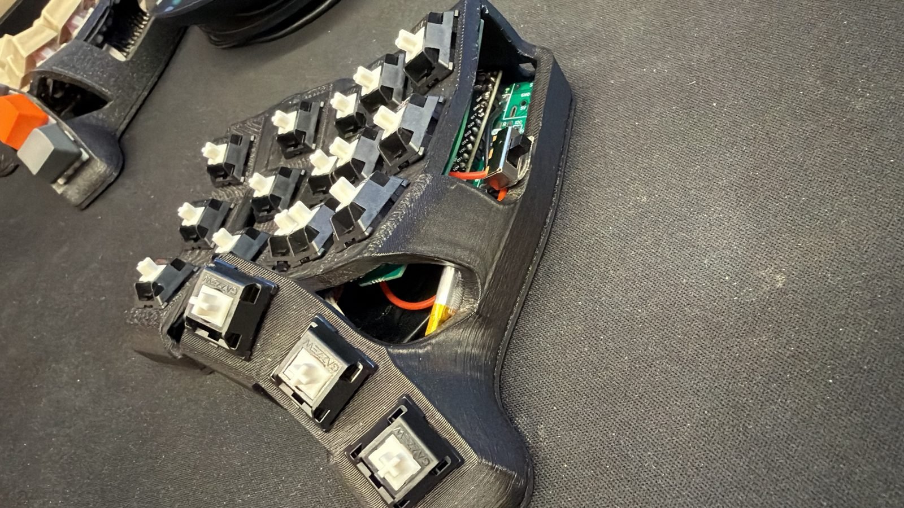

# Skeletyl ZMK config

Wireless [ZMK](https://zmk.dev) firmware for a [BastardKB Skeletyl](https://github.com/Bastardkb/Skeletyl) built with the flex PCB, the [Elite-C holder](https://github.com/Bastardkb/Elite-C-holder) and two nRF52840 Pro Micro controllers (nice!nano v2 compatible).



## Highlights

- **Split, wireless:** the left half is the central (USB and Bluetooth to the computer), the right half joins it over Bluetooth.
- **36 keys, 6 layers:** Base, FN, NAV, Mouse, NUM and SYM, translated from a Vial layout.
- **Home-row mods** (⌘ ⌥ ⌃ ⇧) that only trigger with a key on the opposite half, so fast typing doesn't misfire.
- **Custom shield** for the Skeletyl with the Elite-C holder, since ZMK has no upstream one.
- **Battery** per half with an inline slide switch.

## Repository layout

```
.
├── build.yaml                      # boards/shields built by GitHub Actions
├── config/
│   ├── skeletyl.keymap             # the keymap
│   ├── skeletyl.conf               # Kconfig options
│   ├── west.yml                    # pins ZMK v0.3
│   └── boards/shields/skeletyl/    # shield: matrix pins and transform
├── docs/
│   ├── assembly.md                 # build guide, step by step with photos
│   ├── keymap.md                   # every layer as a table
│   ├── flashing.md                 # getting firmware onto the controllers
│   ├── troubleshooting.md          # problems hit during the build, and fixes
│   └── images/
└── scripts/build.sh                # local Docker build
```

## Firmware

Every push builds both halves in GitHub Actions. Download `firmware.zip` from the latest run on the [Actions tab](../../actions), or build locally:

```sh
scripts/build.sh          # both halves → firmware/skeletyl_{left,right}.uf2
scripts/build.sh left     # one half
```

The local build needs Docker. See [docs/flashing.md](docs/flashing.md) for putting the files on the controllers.

## Documentation

| Doc | What's in it |
|---|---|
| [Assembly](docs/assembly.md) | Parts, diodes, ribbon wiring, controller orientation, battery, switches, case |
| [Keymap](docs/keymap.md) | All 6 layers and how to reach them |
| [Flashing](docs/flashing.md) | UF2, bootloader key, serial DFU fallback |
| [Troubleshooting](docs/troubleshooting.md) | Controller mounted backwards, dead battery pad, bootloader quirks |

## Hardware

| Part | Notes |
|---|---|
| BastardKB Skeletyl case + flex PCBs | 3D-printed case with brass inserts |
| Elite-C holder v2.1 | One per half |
| nRF52840 Pro Micro ×2 | nice!nano v2 clone, UF2 bootloader |
| 1N4148W SMD diodes ×36 | 18 per half |
| 301230 LiPo ×2 | 3.7 V, 110 mAh, 30×12×3 mm |
| SPDT slide switch ×2 | Inline on the battery's positive wire |
| MX-style switches ×36 | |

## Credits

- [BastardKB](https://docs.bastardkb.com) for the Skeletyl, its build guide and the Elite-C holder.
- [ZMK](https://zmk.dev) for the firmware.

## License

[MIT](LICENSE)
