# Assembly

Build guide for a wireless Skeletyl with the flex PCB, the Elite-C holder v2.1 and an nRF52840 Pro Micro. It follows the [BastardKB guide](https://docs.bastardkb.com), with the changes a wireless build needs.

Do every step on both halves. Each half has its own LEFT or RIGHT labelled boards.

| Kit | Flex PCB | Elite-C holder | Controller |
|---|---|---|---|
| 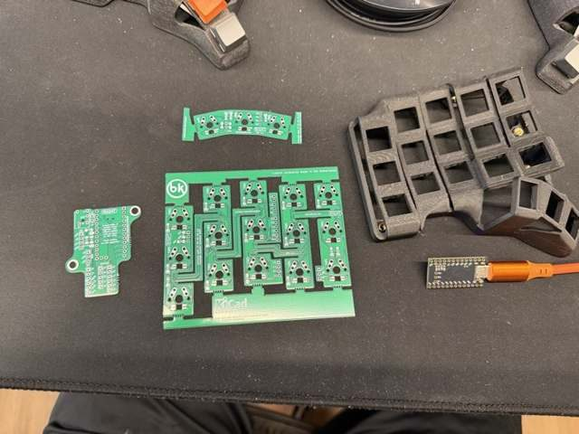 | 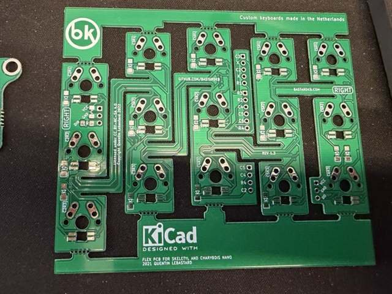 | 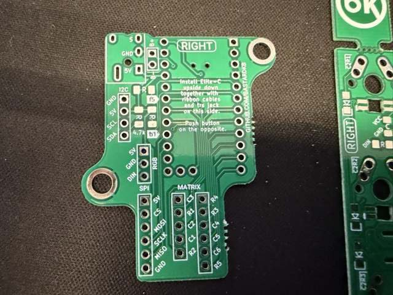 | 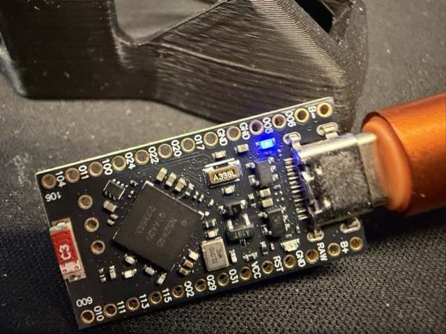 |

**Tools:** soldering iron (300–350 °C), thin solder, flux, tweezers, a multimeter with a continuity beep, flush cutters.

## 0. Flash and label the controllers

Flash before soldering, so a dead controller is caught early. See [flashing.md](flashing.md).

- `skeletyl_left.uf2` goes on the controller for the left half, `skeletyl_right.uf2` on the right one.
- Mark them **L** and **R**.
- Quick test of the left one on USB: touch pins **115** and **029** with a wire. A `q` should appear.

## 1. Screw inserts

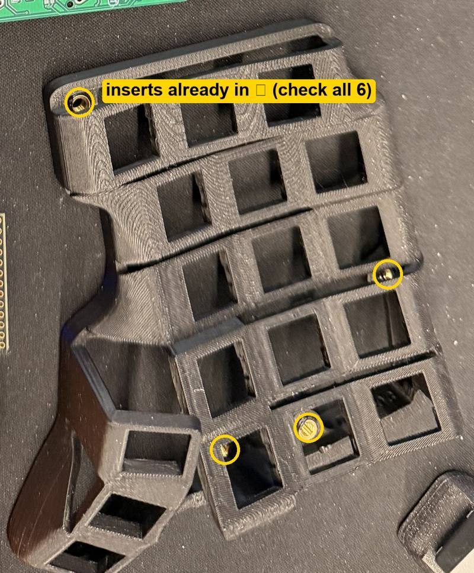

- 6 per half. Skip this step if they are already fitted.
- 4 outer inserts: push ⅔ deep with the iron, flip the iron over and press them flat.
- 2 inner inserts: all the way in.
- Never go above 350 °C, or the case melts.

## 2. Diodes

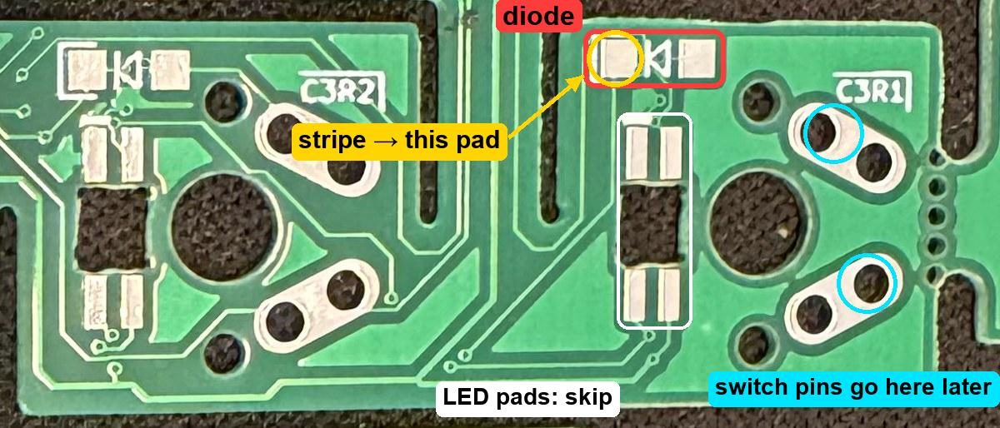

- 18 per half: 15 on the main flex, 3 on the thumb flex.
- The **stripe** on the diode goes to the side marked on the PCB. A reversed diode means a dead key.
- Tin one pad, slide the diode in with tweezers while reheating it, then solder the other pad.
- Skip the LED pads.

## 3. Ribbon wiring

| Main flex: ribbons A and B | Adapter end | Main flex: ribbon C | Thumb flex end |
|---|---|---|---|
| 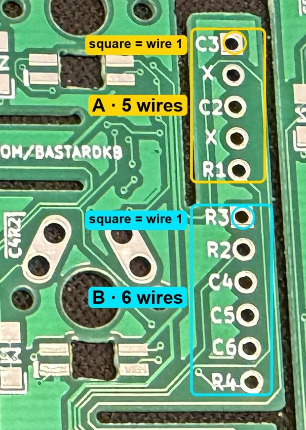 | 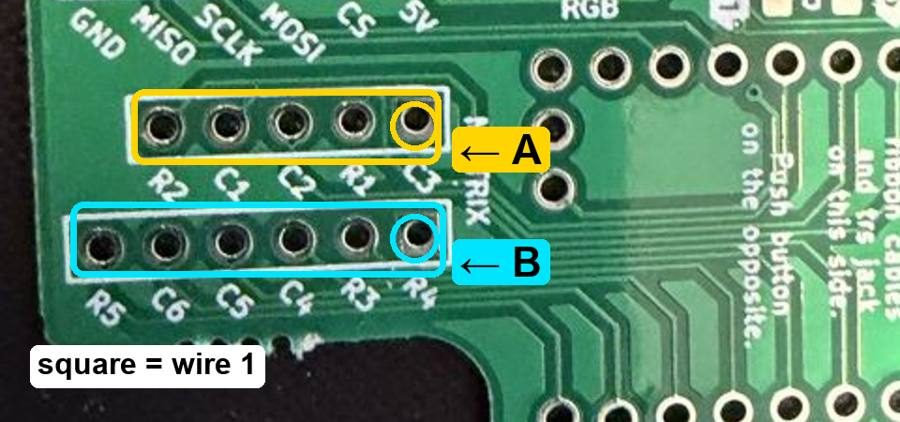 | 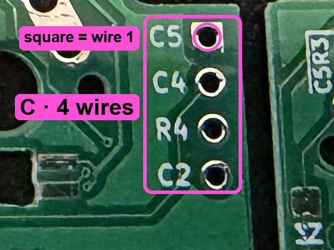 | 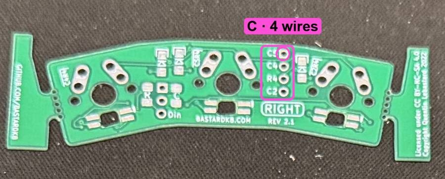 |

- **A** (5 wires) and **B** (6 wires) connect the main flex to the adapter's MATRIX headers. **C** (4 wires) connects the main flex to the thumb flex.
- Run them straight across: square pad to square pad, then each hole to the next one. Never cross wires.
- The labels on the adapter don't match the ones on the flex. Follow the square pads, not the letters.
- Length: about 75 mm for A and B. For C, lay both boards in the case and leave a little slack.
- Push the wires in from the printed side and solder on the back.

The adapter is generic: it has a sixth column and a sixth row (**C1** and **R1**) that the Skeletyl doesn't use.

## 4. Controller on the adapter

| Adapter | Controller pins |
|---|---|
| 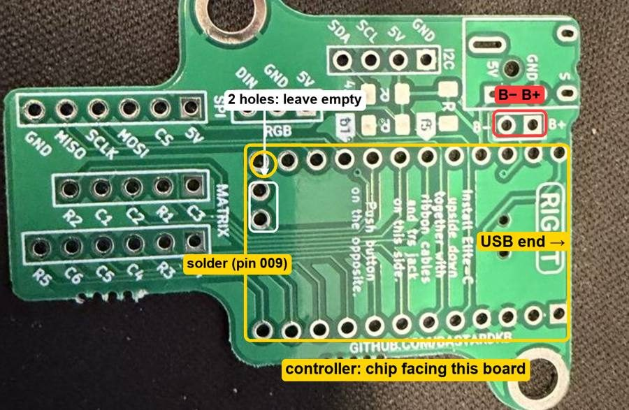 | 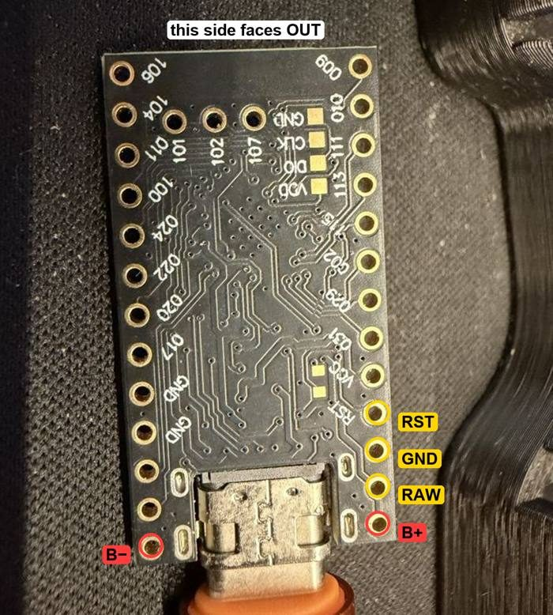 |

> **Orientation matters.** Mount the controller on the side printed *"Install Elite-C upside down"*, **chip facing the adapter**, so the printed pin labels face out. Mounted chip-up on that side, its VCC and RST pins land on ground holes. It then never appears on USB. See [troubleshooting](troubleshooting.md#controller-does-not-appear-on-usb-after-soldering).

1. USB-C points to the end with the B− and B+ pads.
2. Only the 2 holes in the white box stay empty. The ringed end hole takes pin 009.
3. **Solder 2 pins first**, one at each end. With USB unplugged, beep **VCC ↔ GND** and **RST ↔ GND**. Both must stay silent.
4. Plug in USB: the left half shows up as **Skeletyl**. Bridge the adapter's MATRIX holes **R2 + C2** with a wire; a `q` should appear.
5. Solder the rest, alternating ends so one area doesn't overheat.

Skip the reset button and the TRRS jack. The reset button's UPDATE pads end up under the controller. To reach the bootloader later, use the keymap's bootloader key (hold **Z**, tap **Q**).

## 5. Battery and power switch

| Batteries | Wiring (built left half) | Slide switch |
|---|---|---|
| 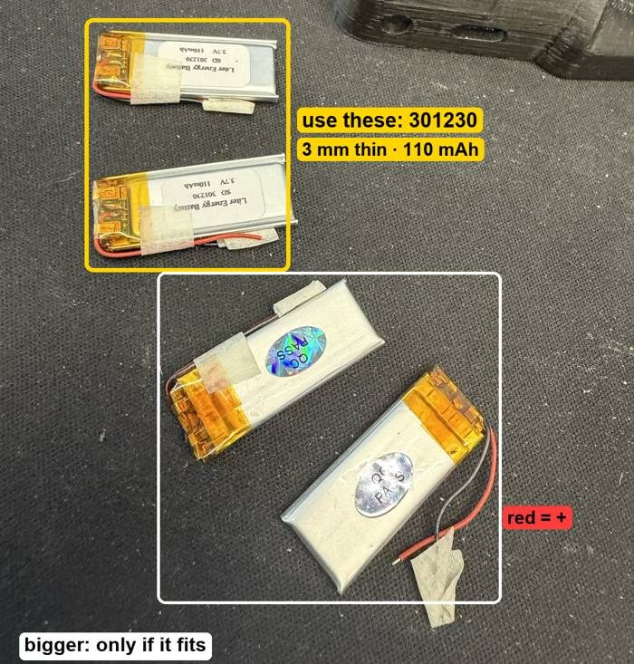 | 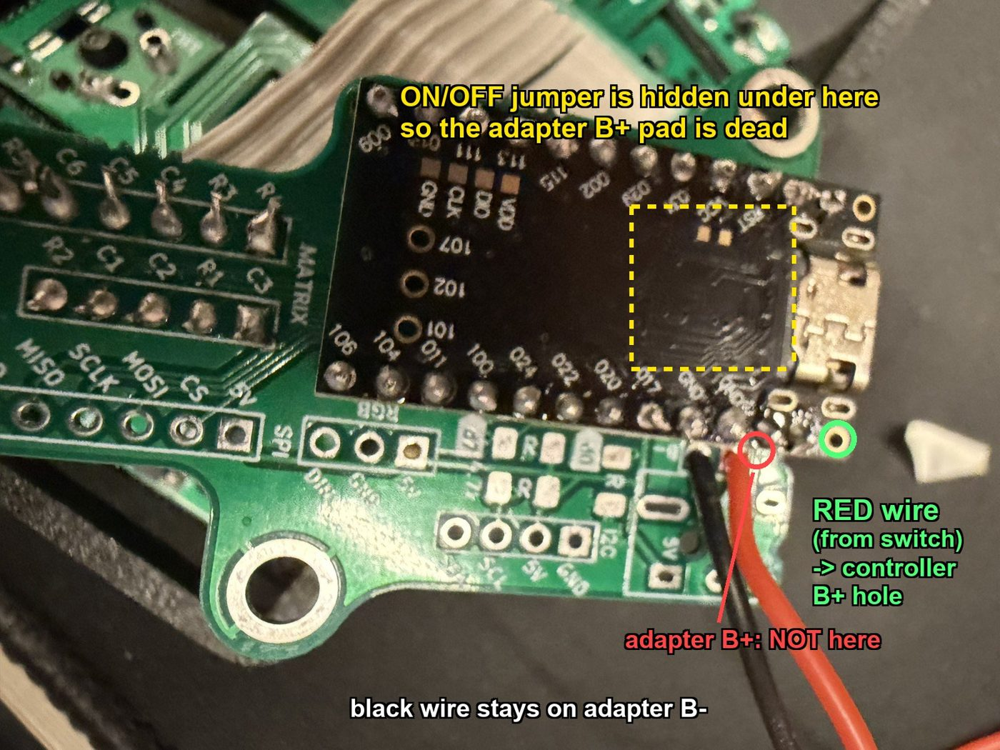 | 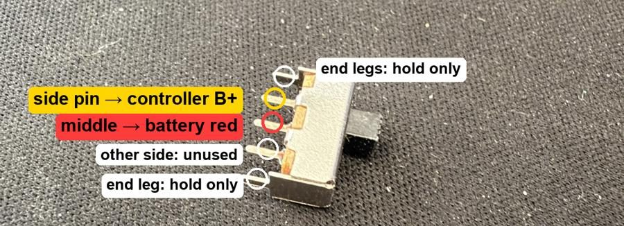 |

The adapter's own B+ pad is wired through its ON/OFF jumper, which ends up **hidden under the controller**. That pad is dead, so take the battery straight to the controller:

```
battery red ──► switch middle pin
switch side pin ──► controller B+  (empty corner hole at the USB end)
battery black ──► adapter B−       (or controller B−)
```

- Red is positive, black is negative. Check with a multimeter before soldering: 3.7–4.2 V.
- Never let the two bare battery wires touch.
- Before connecting the battery, beep controller **B+ ↔ B−**. It must stay silent.
- The battery charges over USB **only with the switch on**, because the switch sits in its positive wire.

| Switch spot | Battery spot |
|---|---|
| 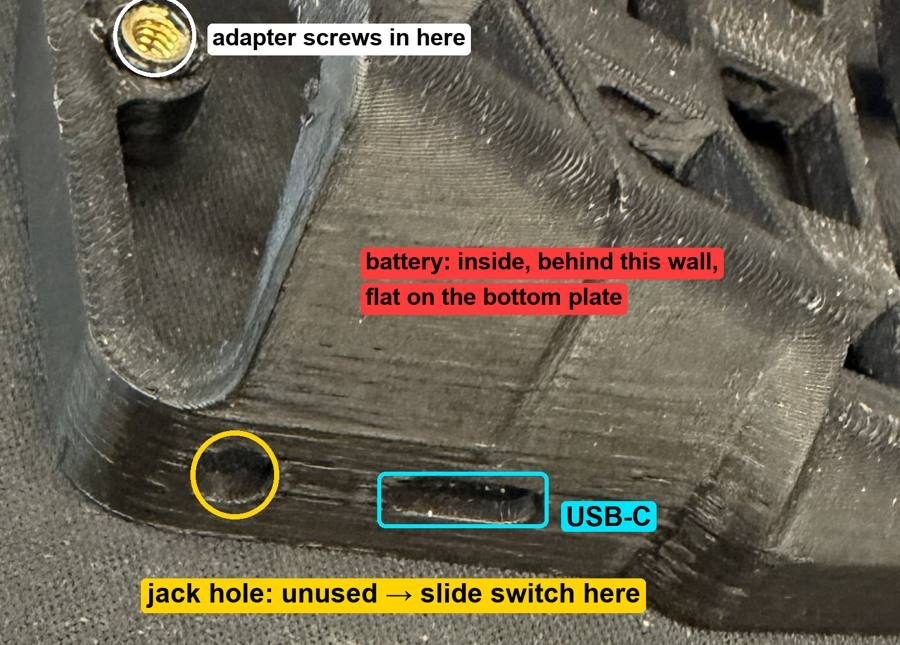 | 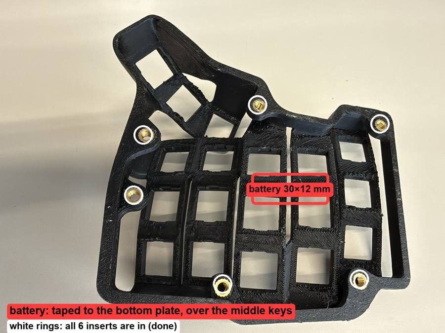 |

- **Switch:** behind the round, unused TRRS jack hole in the case wall, held with hot glue.
- **Battery:** foam-taped to the inside of the bottom plate, over the middle keys. Put tape over the switch pins below it. The plate must close without pressing on the battery.

**Test:** unplug USB and turn the switch on. The left half should appear in your computer's Bluetooth list as **Skeletyl**.

## 6. Test every key before the switches

Bridge each key's two switch holes with tweezers. The left half must be on USB or Bluetooth, and the right half powered.

| Left | 029 | 009 | 100 | 011 | 104 |
|---|---|---|---|---|---|
| **115** | q | w | e | r | t |
| **024** | a | s | d | f | g |
| **022** | z | x | c | v | b |
| **106** | Esc | | Tab | Space | |

| Right | 104 | 011 | 100 | 009 | 029 |
|---|---|---|---|---|---|
| **115** | y | u | i | o | p |
| **024** | h | j | k | l | ' |
| **022** | n | m | , | . | / |
| **106** | | Enter | Bksp | | Del |

A dead key is almost always a reversed diode or a loose ribbon wire.

## 7. Switches

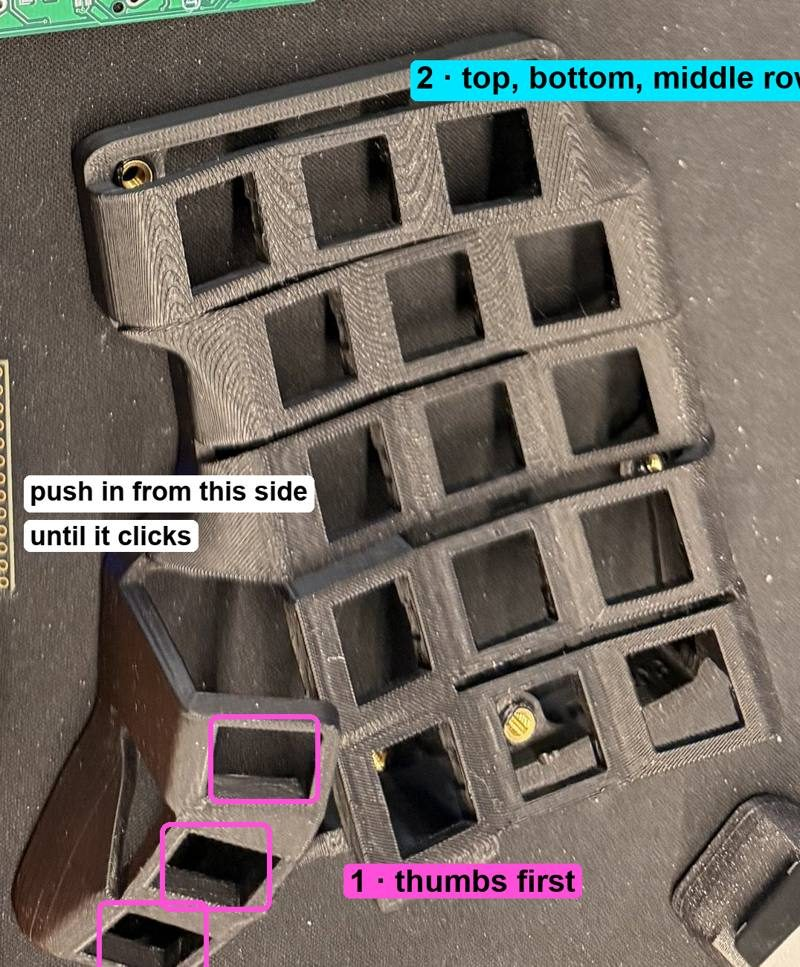

- Order: thumbs first, then the top row, the bottom row and the middle row last.
- Hold the PCB against the case, push the switch in until it clicks, and check that the PCB sits flush.
- Solder one pin per switch first, so you can still straighten one. Then solder the rest.
- Check the pins are straight before pushing a switch in.
- Keep the iron off the case.

## 8. Close the case

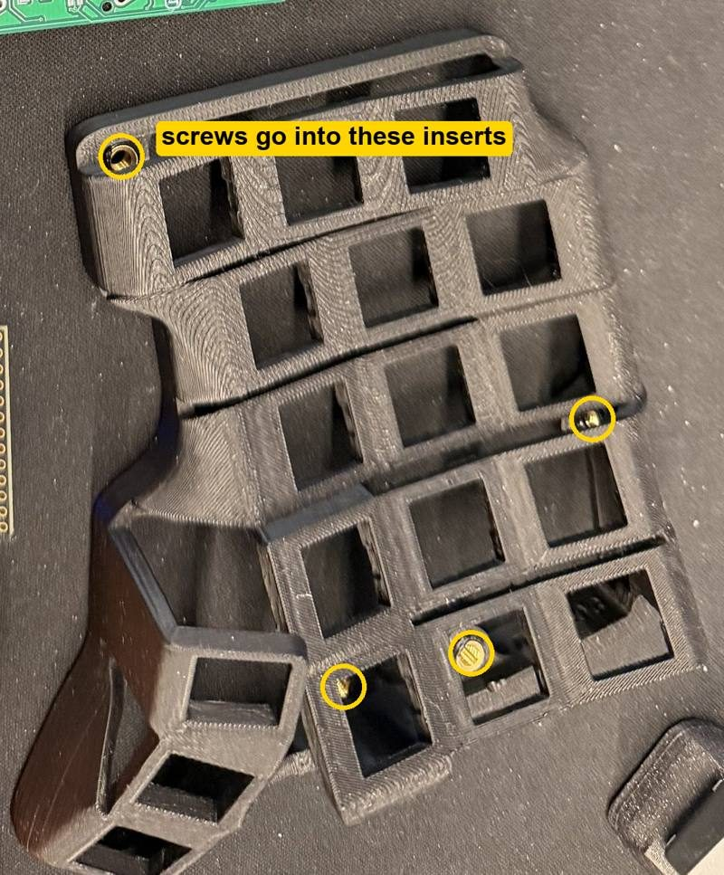

- Adapter: 2 screws into the inner inserts.
- Bottom plate: 4 screws.
- 5 rubber feet.

## 9. Pair

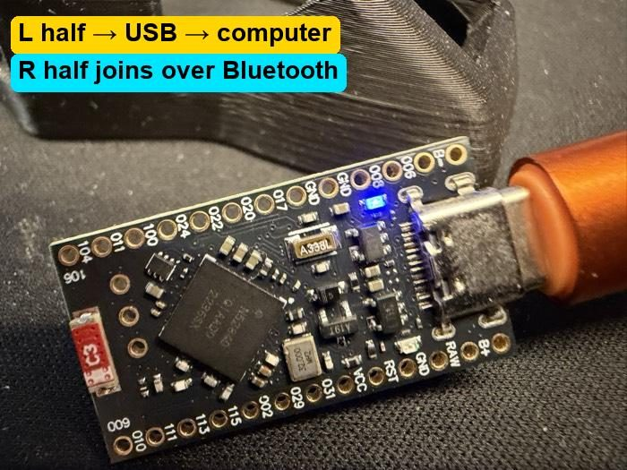

1. Turn both halves on.
2. On the computer, open the Bluetooth settings and connect to **Skeletyl**.
3. The right half joins the left one by itself.
